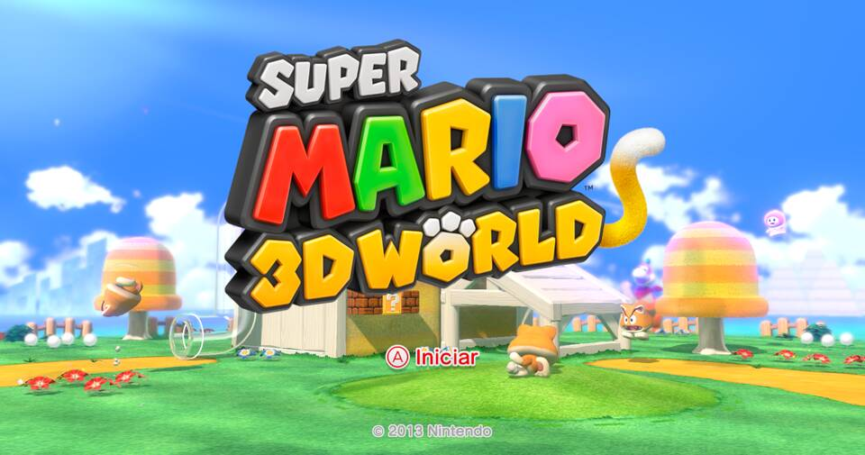
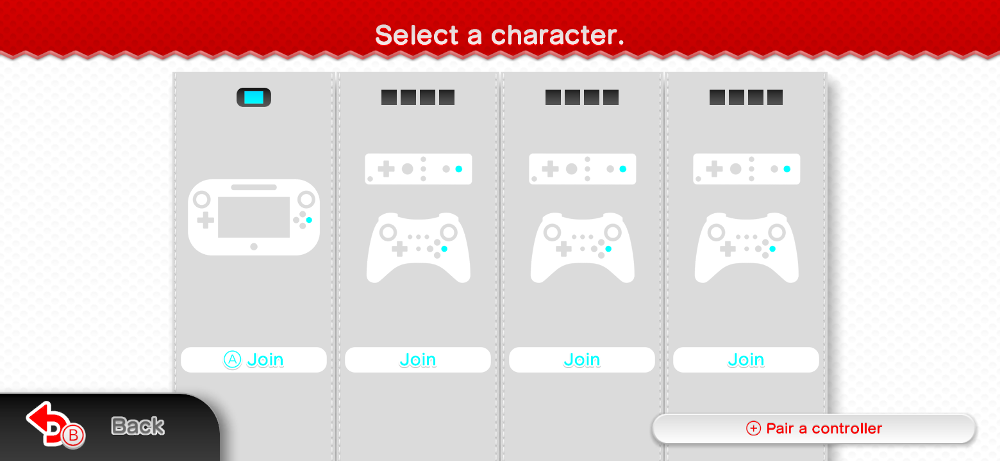
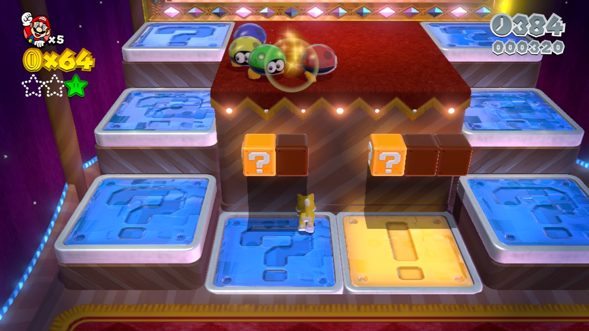
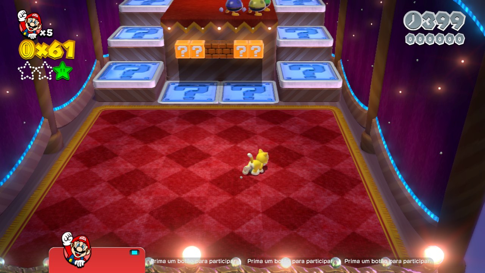

<div align="center">


# 3dWorldRecomp

**A Wii U 3D platformer, statically recompiled to native code for Android and PC.**

The game's PowerPC code is translated to C ahead of time, the Cafe OS libraries are reimplemented natively and its GX2<br>
graphics are drawn straight with Vulkan. No CPU or GPU emulation. Bring your own dump.


<a href="LICENSE"></a>

<a href="#-building"></a>
<a href="#%EF%B8%8F-how-it-works"></a>
<a href="docs/"></a>
<a href="https://www.youtube.com/@belmante"></a>

</div>

---

> [!IMPORTANT]
> **No game files, no game code and no keys are included.** This project is a runtime and a recompiler for
> *Super Mario 3D World* (Wii U, EUR Rev 1, `RedCarpet.rpx`). You need your own legally obtained copy, dumped from your
> own console. The recompiled code and any APK built from it **contain the game and must never be shared**.

## 📸 Screenshots

<div align="center">

| Title | Character select |
|:---:|:---:|
|  |  |
| **World 1-5 (circus)** | **World 1-5, BC1 textures as ASTC** |
|  |  |

</div>

## ✨ Features

| | |
|---|---|
| 🚀 **Native** | 54,075 game functions recompiled to C (~35 s on a PC). The Cafe OS (coreinit, GX2, sound, input, saves) is reimplemented natively. |
| 🎨 **Vulkan renderer** | GX2 drawn with Vulkan 1.3 (Vulkan 1.1 fallback with classic render passes), Metal on macOS. Shaders translated with Cemu's Latte decompiler, cached and pre-built. |
| ⚡ **Fast** | 60 fps on a weak integrated Intel UHD (automatic preset), up to 120 fps on phones and PCs, automatic resolution, frame skip and a 30 fps full-speed mode for slow devices. |
| 🪶 **Light** | On GPUs without BC textures (Adreno and Mali drivers): BC4/BC5 kept as R8/RG8 and BC1 transcoded to ASTC 4x4, **270 → 86 MiB** of textures in stage 1-5. Texture budget and low-memory trimming on Android. |
| 🎮 **Every GamePad feature** | Buttons and sticks (controllers, keyboard, on-screen touch), the touch screen (touch the picture itself on a phone), rumble, **gyro** (phone sensors, controllers, DSU) and **blowing into the microphone**. |
| 📦 **Android app** | Imports your `.wux`/`.wud` + `keys.txt`, a `.wua` or a folder on the phone itself. Save import/export, in-game menu, Turnip driver support, heat guard. |
| 🌍 **Your language** | Every language of your dump, Portuguese included. |

## 📋 Requirements

| | |
|---|---|
| **Game** | *Super Mario 3D World*, **EUR Rev 1** (title `0005000010145d00`, `RedCarpet.rpx` SHA-256 `a254…4937`), your own dump: `.wux`/`.wud` + `keys.txt`, `.wua`, or an extracted folder |
| **Android** | Android 13+, ARM64, Vulkan 1.3 GPU (tested on a Galaxy S23, Snapdragon 8 Gen 2) |
| **PC** | Linux, Windows or macOS; any Vulkan GPU (integrated Intel UHD included) or Metal on macOS |
| **Build** | clang/gcc (C++20), CMake, Ninja, Python 3, Vulkan headers, SDL3, zlib, zstd; Android SDK + NDK 28 and JDK 17 for the APK |

## 🛠️ Building

The game code is generated on **your** computer from **your** dump, then built into the PC executable or the APK.

```sh
git clone https://github.com/BelmanteGu/3dWorldRecomp
cd 3dWorldRecomp
# 1. extract YOUR dump into game3dw/ (code/RedCarpet.rpx, content/, meta/), e.g. with tools/wudextract.py (git-ignored)
RECOMP_GAME=sm3dw python3 tools/recomp/recomp.py game3dw/code/RedCarpet.rpx build/gen3dw    # ~35 s
# 2. PC
cmake -S . -B build/vk -G Ninja -DCMAKE_BUILD_TYPE=Release -DGEN_DIR=$PWD/build/gen3dw -DWWHD_GAME_RPX=RedCarpet.rpx
ninja -C build/vk wwhd
build/vk/wwhd --game game3dw --save save           # F1 opens the settings
```

**Android** (full steps in [docs/android-build.md](docs/android-build.md)):

```sh
cd android
GEN_DIR=$PWD/../build/gen3dw EXTRA_CMAKE_ARGS=-DWWHD_GAME_RPX=RedCarpet.rpx NDK_VERSION=28.2.13676358 \
  CPU=generic ./build_native.sh                     # CPU=cortex-a78 for a Galaxy S23
JAVA_HOME=<jdk-17> ./build_sm3dw_apk.sh             # -> dist/SM3DW-test.apk, for your own phone only
```

Install the APK, open it and tap **Import game**: pick your `.wux`/`.wud` (with `keys.txt` next to it), a `.wua` or a
folder. Everything stays on the phone.

## ⚙️ How it works

```
your dump ──► tools/recomp ──► C code (build/gen3dw, local only)
                                   │
                                   ▼
               ┌──────────── native executable / libmain.so ────────────┐
               │ recompiled game code  ──►  Cafe OS HLE (coreinit, GX2,  │
               │                            AX audio, VPAD/KPAD, FS,    │
               │                            saves, microphone)          │
               │                                │                       │
               │                                ▼                       │
               │          GX2 commands ──► Vulkan / Metal renderer       │
               │          (Latte shaders → SPIR-V, texture tiling,      │
               │           BC → R8/RG8/ASTC on mobile GPUs)             │
               └────────────────────────────────────────────────────────┘
                     SDL3: window, audio, controllers, touch, sensors
```

More in [docs/architecture.md](docs/architecture.md), [docs/vulkan.md](docs/vulkan.md) and [docs/android-gpu.md](docs/android-gpu.md).

## 📊 Status

| | |
|:---:|---|
| ✅ | Boots, plays and saves, from the title screen through the worlds |
| ✅ | Android (Galaxy S23): 60 and 120 fps modes, automatic resolution, touch controls, gyro, microphone blowing |
| ✅ | PC: 60 fps on an Intel UHD (ADL-S GT0.5) by default, 90–130 fps uncapped with the Intel 120 preset |
| ✅ | Pipeline cache and pre-translated shader pack against shader-compile stutter |
| 🚧 | Low-end Adreno/Mali phones, Vulkan 1.1 devices |

Reports from other phones (especially Mali/Exynos/Tensor GPUs) are very welcome: open an [issue](../../issues).

## 📚 Documentation

[architecture](docs/architecture.md) · [benchmark](docs/benchmark.md) · [Intel 60 preset](docs/intel60.md) ·
[Intel 120 preset](docs/intel120.md) · [120 fps](docs/sm3dw-120fps.md) · [30 fps (full speed)](docs/30fps.md) ·
[frame skip](docs/frameskip.md) · [controls, touch and gyro](docs/controls.md) · [microphone (blowing)](docs/mic.md) ·
[GamePad features](docs/gamepad-features.md) · [save import/export](docs/save-import-export.md) ·
[Android build](docs/android-build.md) · [environment variables](docs/env-vars.md) · [roadmap](docs/roadmap.md) ·
[studies](docs/studies/)

## ⚖️ Legal

- This is an unofficial fan project. It is **not affiliated with, endorsed or sponsored by Nintendo**. *Super Mario 3D
  World* and every related name and image are trademarks and property of Nintendo.
- This repository contains **no** game code, game assets or keys. The game-specific code is generated locally from your
  own dump and **must not be redistributed**, nor any APK or executable built from it. Releases of this project, if any,
  contain only the runtime and tools.
- The screenshots show the game running on this runtime, for documentation.

## 💜 Credits

- Built on the [Zelda WWHD Recomp](https://github.com/ZeldaWWHDRecomp/ZeldaWWHDRecomp) runtime (MPL-2.0) and its
  contributors, including rhemfur's Android port and GreenNaugahyde's Android work
- [Cemu](https://github.com/cemu-project/Cemu) (MPL-2.0): the Latte shader decompiler and GPU address library
- [Fractal](https://github.com/dfdx047/Fractal): the idea of BC → ASTC transcoding and lazy zero pages on Android
- [SDL3](https://libsdl.org/), [glslang](https://github.com/KhronosGroup/glslang), [Dear ImGui](https://github.com/ocornut/imgui),
  [{fmt}](https://github.com/fmtlib/fmt), [zstd](https://github.com/facebook/zstd), [libadrenotools](https://github.com/bylaws/libadrenotools)
- And the game itself, by Nintendo EAD Tokyo. Go buy it.

<div align="center">

**Made by [Projeto Belmante](https://www.youtube.com/@belmante)** · Mozilla Public License 2.0 · Third-party components keep their own licenses

</div>
